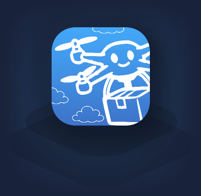
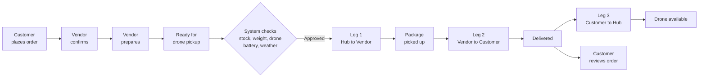

<div align="center">



# AeroDrop

### A Campus Drone Delivery System for UCLM


*Order from campus vendors and have it flown to your drop zone.*

</div>

---

## About

**AeroDrop** is a capstone project by Bachelor of Science in Information Technology students of the **University of Cebu Lapu-Lapu and Mandaue**. It is a campus marketplace and drone delivery application for ordering and delivering small items within the university.

The system connects campus users with approved vendors. Users browse products, place orders, message the vendor, track the drone on a live map, and review what they received. Vendors manage products, inventory, and orders. Administrators oversee accounts, drones, deliveries, weather, support, and analytics.

> [!NOTE]
> Drone flight and telemetry are **simulated**. Online payments run through the **Xendit sandbox** (no real money). Weather, campus coordinates, authentication, messaging, reviews, and all stored records are **real**.

---

## Highlights

| | |
|---|---|
| **Live campus weather** | Real conditions polled every 15 minutes, mapped to drone operating limits |
| **Interactive map tracking** | OpenStreetMap tiles with real campus coordinates and live drone position |
| **Physics-aware flight** | Flight time from real distance; payload affects speed and battery |
| **Order chat** | Realtime messaging between customer and vendor while an order is active |
| **Multi-trip payloads** | Orders too heavy for one flight are carried in two, with the drone shuttling back to the vendor |
| **Support conversations** | Reporters and admins exchange messages and photos on a ticket, not a one-way form |
| **Verified accounts** | Email one-time codes, plus Google sign-in for customers |
| **Real payment gateway** | GCash and card through Xendit in sandbox mode, confirmed by webhook |
| **Transparent fees** | Distance and weight based, priced by the server, with a full breakdown before you pay |
| **Reviews and ratings** | Store and product ratings from verified deliveries |
| **Analytics export** | Admin reports exportable to CSV and PDF |

---

## Account Types

<table>
<tr>
<td width="33%" valign="top">

### User
Students, faculty, and staff who browse products and place delivery orders.

</td>
<td width="33%" valign="top">

### Vendor
Approved campus stores that manage products, inventory, and incoming orders.

</td>
<td width="33%" valign="top">

### Admin
Staff who manage accounts, drones, deliveries, weather, support, and reports.

</td>
</tr>
</table>

---

## Authentication

| Method | Who | Verification |
|---|---|---|
| **Email and password** | Users, Vendors, Admins | One-time code sent by email at registration and at each login |
| **Continue with Google** | Customers | None required — Google already verified the address |

Vendors register through the full application form because store details are needed, though approved vendors may then sign in with Google. Administrators cannot use Google sign-in. Password reset also uses emailed one-time codes.

> [!IMPORTANT]
> SMS verification is **not implemented**. If phone verification is selected, the app honestly reports that SMS is unavailable and directs the user to email.

---

## Features

<details open>
<summary><b>User Side</b></summary>

<br>

- Registration and login with email verification codes
- Google sign-in for customer accounts
- Profile and profile-picture management
- Browse approved campus vendors, then view each store's products
- Search products and view detailed information
- Store and product ratings from real customer reviews
- Cart management with live totals
- Order confirmation step before payment
- Delivery fee from real distance and package weight, with a visible breakdown
- Warning in the cart when an order is heavier than one drone load, and how many trips it will take
- Pay online with GCash or card through Xendit (sandbox), or use the simulated payment options
- **Message the vendor** about an active order, with realtime delivery and unread counts
- Live drone tracking on an interactive campus map
- Order and delivery history with official receipts
- Cancel orders while the vendor is still preparing
- Optional store and product reviews after delivery
- Raise a support report and keep talking to support about it, attaching up to three photos per message
- Read the Terms and Privacy Policy before accepting them, and again from the profile at any time
- Notifications with unread counts
- Current campus weather conditions (read-only)

</details>

<details>
<summary><b>Vendor Side</b></summary>

<br>

- Vendor registration and application, with admin approval required
- Business profile management with logo upload
- Predefined and custom store categories
- Add, edit, and deactivate products with price, weight, and stock
- Incoming order list with action counts on the navigation bar
- Confirm or reject orders, mark as preparing, then ready for drone pickup
- **Message the customer** about an incoming order, with realtime delivery and unread counts
- Raise a support report and hold a conversation with an administrator about it
- Automatic inventory updates on orders and cancellations
- Store and product reviews
- Vendor notifications and sales information
- Current campus weather conditions (read-only)

</details>

<details>
<summary><b>Admin Side</b></summary>

<br>

- Secure admin login without verification codes
- Account management, vendor approval, suspension and reactivation
- Orders and deliveries, including orders cancelled before dispatch
- Live campus drone radar with route and telemetry
- Drone availability, battery, and status monitoring
- Weather management with temporary manual override
- Support queue: reply to reporters in a thread, attach photos, add private notes, resolve or reopen
- Read-only access to customer and vendor conversations for dispute handling
- In-app notification centre covering vendor applications, deliveries, cancellations, expired payments, weather changes, drone battery, and new support reports
- No-fly-zone records and delivery status logs
- Reports and analytics, exportable to CSV and PDF
- Live badge counts for active deliveries

</details>

---

## Delivery Workflow



The customer may cancel at any point up to **Ready for drone pickup**. Cancellations automatically restore stock and refund simulated payments. The order chat stays open throughout, from the moment the order is placed until it is delivered or cancelled.

---

## Multi-Trip Deliveries

One drone load is **0.5 kg**. An order heavier than that is not refused: it is flown in **two trips**, up to a ceiling of **1.0 kg**. Anything above that has to be split into separate orders.

The cart warns as soon as an order crosses one load, states how many trips it will need, and asks the customer to confirm before the order is placed. Above the ceiling, checkout is blocked rather than failing at the server.

Between trips the drone **shuttles straight back to the vendor** for the next load rather than returning to base:

```
Hub -> Vendor -> Customer -> Vendor -> Customer -> Hub
```

The tracking screen names the stage throughout, so "Returning to Base" never appears while a load is still owed. A single-trip order flies the ordinary route and shows no trip labels at all.

The trip count is derived by the database, never sent by the client, and recomputed at dispatch so a stock or weight change since checkout is caught. Dispatch also requires enough battery for **every** trip, not just the first, and an order left part-flown by grounded weather or a flat battery is retried automatically and reported to administrators if it stays stuck.

---

## Order Chat

Customers and vendors can message each other about an order, in the manner of a food delivery app, so questions about preparation or the drop-off point do not require leaving the system.

| Rule | Behaviour |
|---|---|
| **Who can talk** | Only the order's customer and its vendor |
| **When it opens** | As soon as the order exists — for online payments, once payment is confirmed |
| **When it closes** | On delivery, cancellation, rejection, or failure; the history stays readable |
| **Admins** | May read any conversation for dispute handling, but can never post |
| **Editing** | Messages cannot be edited or deleted by anyone, so the thread is a reliable record |
| **Delivery** | Realtime, with an unread badge on the order and a single notification per thread |

Messages arrive over Supabase Realtime, so neither side needs to refresh. Notifications are deliberately collapsed to **one unread alert per conversation** rather than one per message, so an active exchange does not flood the notification list.

Access is enforced in the database rather than the interface: row level security checks each message against the parent order, so participation cannot be forged by a modified client. Because vendors are not permitted to read customer profiles, the counterpart's name and photo are served by a dedicated security-definer function that reveals only the other party on an order the caller actually belongs to.

---

## Notifications

Every role has an in-app notification centre with unread counts.

| Audience | Notified about |
|---|---|
| **Customer** | Order status changes, payment outcomes, cancellations and refunds, delivery progress, each trip of a multi-trip order, new messages, and every support reply |
| **Vendor** | New and cancelled orders, drone pickup, delivery completion, new messages |
| **Admin** | Vendor applications, completed and failed deliveries, cancelled orders, expired payments, weather caution and grounding, low drone battery, stalled drone returns, part-flown orders that cannot continue, new support reports and every reporter reply |

Weather groundings are reported to administrators as a **single consolidated alert** carrying the number of orders cancelled, rather than one notification per affected order.

---

## Support Conversations

A customer or vendor can report a problem from Help and Support, optionally tied to a specific order or delivery. A report is not a form that disappears: it opens a **conversation**.

| | |
|---|---|
| **Who can talk** | The reporter and any administrator |
| **Attachments** | Up to three images per message, so a damaged delivery can be shown rather than described |
| **Reopening** | A reporter replying to a resolved report reopens it; an administrator's reply does not |
| **Editing** | Messages cannot be edited or deleted, so the thread stands as a record |
| **Delivery** | Realtime, with unread counts and a single collapsed alert per report |

Every administrator is notified when a report is filed and when a reporter replies; the reporter is notified when support answers and when the report is resolved. Alerts collapse to **one unread per report** so an active exchange does not flood anyone — with one deliberate exception: reopening always notifies, because it is how a reporter says a fix did not work, and that is the message that must not be swallowed.

Attachments live in a **private** storage bucket, unlike the public buckets used for avatars and store logos. A support photo may show a damaged order, a room, or a face, so the files are readable only by that thread's participants and are served through short-lived signed links.

---

## Drone Setup

<table>
<tr><td><b>Drone Code</b></td><td>DRN-001</td></tr>
<tr><td><b>Drone Name</b></td><td>AeroCarrier Alpha</td></tr>
<tr><td><b>Model</b></td><td>Prototype 001</td></tr>
<tr><td><b>Maximum Payload</b></td><td>0.5 kg per trip (up to 1.0 kg across two trips)</td></tr>
<tr><td><b>Minimum Battery for Dispatch</b></td><td>15%</td></tr>
<tr><td><b>Statuses</b></td><td>Available, Assigned, Busy, Returning, Charging, Maintenance, Offline</td></tr>
</table>

### Flight Model

Every delivery runs in three legs:

| Leg | Route | Load |
|---|---|---|
| **1** | Base hub to Vendor | Empty |
| **2** | Vendor to Customer | Loaded |
| **3** | Customer to Base hub | Empty |

An order needing two trips inserts an extra pair of legs before the last one: Customer to Vendor empty, then Vendor to Customer loaded again.

Flight time comes from the **real distance** between campus coordinates divided by the drone's effective speed, with sensible minimum and maximum durations. Carrying a payload reduces speed and increases battery drain on the loaded leg only. Caution weather slows flights further. A recovery mechanism returns the drone to service if a return flight is interrupted.

---

## Live Campus Weather

Real weather for the UCLM campus is polled from **Open-Meteo** every 15 minutes by scheduled database jobs, then mapped to three operating states using the limits of a small delivery multirotor.

| State | Conditions | Effect on operations |
|---|---|---|
| **Safe** | Wind up to 15 km/h, gusts up to 25 km/h, no rain | Normal delivery |
| **Caution** | Wind 15-28 km/h, gusts 25-40 km/h, light rain below 0.5 mm/h | Slower flights, longer ETAs, small surcharge |
| **Grounded** | Wind above 28 km/h, gusts above 40 km/h, rain 0.5 mm/h or more, thunderstorm, visibility under 1 km, temperature above 40 C | New orders blocked, active orders cancelled and refunded, drones return to base |

These thresholds reflect the roughly 12 m/s wind rating of small multirotors, the absence of weather sealing on consumer drones, and the reduced margin when carrying a payload.

> [!TIP]
> Administrators can override the weather state for demonstrations. An override lasts two hours by default, displays the real conditions alongside it, and can be ended instantly with a resume action. Customers and vendors only see the resulting status.

---

## Payments

AeroDrop offers three payment options at checkout.

| Option | How it works |
|---|---|
| **Pay online (GCash or Card)** | Creates a real invoice through **Xendit**, the Philippine payment gateway. The customer completes payment on Xendit's hosted page, and the order is confirmed by a server-side webhook. |
| **Simulated GCash** | Marked paid immediately. Kept as an offline fallback for demonstrations without internet. |
| **Simulated Card** | Card details are validated locally (Luhn check, expiry, CVC) and never stored. Also marked paid immediately. |

The Xendit integration runs in **test mode**, so no real money moves. Going live requires business verification, which is outside the scope of this project.

How the online payment flow is kept secure:

- The gateway secret key is stored in Supabase and **never ships inside the app**.
- A Supabase Edge Function creates the invoice, reading the amount **from the database** rather than from the client, so the charge always matches the order.
- A second Edge Function receives Xendit's webhook, verified by callback token, and marks the order paid. The update is idempotent, so repeated webhooks change nothing.
- Vendors cannot see or act on an order until payment is confirmed, and the order chat stays closed until then for the same reason.
- If an invoice expires unpaid, the order is cancelled automatically and reserved stock is returned.

Cancelling a paid order marks it refunded and restores stock. Refunds are simulated rather than sent back through the gateway.

---

## Delivery Fees

The fee is calculated from a **base fee** charged once, the **real distance** between vendor and drop-off charged **per trip**, the **package weight**, a flat **extra-trip charge** for each flight beyond the first, and a **surcharge during Caution weather**. The full breakdown is shown at checkout before payment, and again on the receipt and order details.

The extra-trip charge exists because distance alone would make a second flight free when the vendor and the drop-off are in the same building, even though it is another launch, another battery cycle and another handover.

**Every amount is calculated in the database.** The app and the website do not price an order; they ask the server for a quote and display what it returns, so the figure on screen is the figure that will be charged. Item prices, weights, distance and trip count are read from the stored product and location rows rather than from anything the client sends.

---

## Campus Locations

AeroDrop operates inside the University of Cebu Lapu-Lapu and Mandaue campus using real coordinates.

| Location | Role |
|---|---|
| Old Building (Main Building) | Pickup / Drop-off |
| Annex 2 Building | Pickup / Drop-off |
| Basic Education Building | Pickup / Drop-off |
| Maritime Building | Pickup / Drop-off |
| **Campus Drone Hub** | Drone base station |

The Campus Drone Hub is the drone's home base and cannot be selected as a customer drop-off point.

---

## Security Model

Access control lives in the database, not in the interface, so a modified client gains nothing.

- **Row level security** on every table. Customers reach their own records, vendors reach their own store and the orders placed with it, and administrators reach what their role requires.
- **Server-side pricing.** No client decides what an order costs. Orders can only be created through `place_order`, which derives the subtotal, weight, trip count, distance and every fee component from the stored product and location rows. Clients ask for a quote through the same function so they display the price they will be charged, and a tampered request is priced the same as an honest one.
- **Rate limits in the database.** Orders, support reports, order chat and support chat each carry an insert limit per account, enforced by triggers rather than by the interface, so the limit holds for any client. Administrators are exempt, since working a support queue means many messages in a short burst.
- **Security-definer functions** for operations that must cross those boundaries — placing an order, cancelling one, submitting reviews, notifying administrators, resolving a chat counterpart's name. Each one re-checks the caller's right to act before doing anything.
- **Immutable records** where a history matters: order chat and support messages have no update or delete path at all.
- **Private storage for sensitive files.** Avatars and store logos sit in public buckets; support attachments do not. They are readable only by that thread's participants and are served through short-lived signed links.
- **Recorded consent.** Accepting the Terms and Privacy Policy at registration is stored against the account, and both documents are readable before acceptance rather than only after signing in.
- **Explicit grants.** Supabase stopped auto-granting Data API access to new tables in October 2026, so every table's privileges are declared in the migrations. This keeps the migration history self-sufficient: a fresh project rebuilt from `supabase/migrations` works without manual repair.
- **Secrets stay server-side.** The payment gateway key, callback token, and mail credentials live in Supabase configuration and are never bundled into the app.

---

## Web Companion

A browser version of AeroDrop lives in [`website/`](website), built with React, Vite and TypeScript and deployed on Vercel. It talks to the same Supabase project as the app, so the same accounts, orders and row level security apply.

It covers browsing, ordering, tracking, support conversations and the vendor console, and prices every order through the same server quote the app uses. Placing an order there ends on a printed receipt that feeds out of a printer, the same moment the app gives after payment. Features built most recently in the app may not have reached it yet.

---

## Technology Stack

<table>
<tr>
<td valign="top" width="33%">

**Application**
- Flutter
- Dart
- Riverpod
- GoRouter
- flutter_map
- Material Design

</td>
<td valign="top" width="33%">

**Backend**
- Supabase Auth (+ Google OAuth)
- Supabase PostgreSQL
- Supabase Storage
- Supabase Realtime
- Functions, triggers, RLS
- Edge Functions (Deno)
- pg_cron, pg_net

</td>
<td valign="top" width="33%">

**External Services**
- Xendit (payments, sandbox)
- Open-Meteo (weather)
- OpenStreetMap (map tiles)

**Web Companion**
- React, Vite, TypeScript
- Vercel

</td>
</tr>
</table>

---

## Getting Started

### Requirements

- Flutter with **Dart SDK 3.12.2** or newer
- A Supabase project with the migrations in `supabase/migrations` applied in order
- Platform tools for your target (Android Studio, or Xcode and CocoaPods for iOS/macOS)

### Setup

```bash
git clone https://github.com/Rzenz/AeroDrop.git
cd AeroDrop
flutter pub get
```

On macOS or iOS, also run:

```bash
cd macos && pod install && cd ..
```

### Running

Supabase credentials are **not** stored in the repository. Provide them at run time:

```bash
flutter run \
  --dart-define=SUPABASE_URL=https://your-project.supabase.co \
  --dart-define=SUPABASE_ANON_KEY=your-publishable-key
```

The same two definitions are required when building a release APK:

```bash
flutter build apk --release \
  --dart-define=SUPABASE_URL=https://your-project.supabase.co \
  --dart-define=SUPABASE_ANON_KEY=your-publishable-key
```

### Database

Schema, functions, triggers, policies, and scheduled jobs live in `supabase/migrations`, applied in numeric order. Weather polling requires the **pg_cron** and **pg_net** extensions enabled in the Supabase project, and realtime must be enabled for the tables the migrations add to the `supabase_realtime` publication.

---

## Attribution

Map data and tiles are provided by **OpenStreetMap contributors**, used under the OpenStreetMap Tile Usage Policy. Weather data is provided by **Open-Meteo**. Online payments are processed by **Xendit** in test mode.

---

<div align="center">

### Project Status

AeroDrop is a **working prototype**. Drone flight and telemetry are simulated, while online payments run through a real gateway in sandbox mode, and weather, campus coordinates, authentication, messaging, reviews, and all stored records are real.

**Future work:** SMS verification, live payment processing after business verification, physical drone integration, and public app store release.

<br>

*Developed by 4th year BSIT students of the University of Cebu Lapu-Lapu and Mandaue*

</div>
